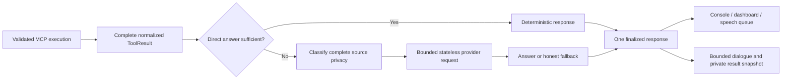

# Conversational MCP results

MCP execution and response interpretation are separate steps. The server still
owns its tool contract and filesystem permissions; Coda still validates arguments,
trust, exact allowlists, confirmations and configuration revisions before execution.
An interpretation cannot grant permission, call another tool or replay an action.



## Usage

Both manual and voice modes use the same response path. Manual input still requires
the configured wake word:

```text
coda can you read the file at G:/GitRepos/coda/README.md?
coda what does it say about MCP?
coda show tool output
coda show full tool output
```

The first request requires a configured/authorized server and an absolute path.
The follow-up uses the retained result without reading the file again when it
clearly refers to the active tool discussion. A known native command takes
precedence over implicit follow-up detection. Missing context asks which result
is meant; a request to refresh/read again goes through ordinary routing.

`CODA:` contains the exact text queued for TTS, not the raw README. The compatibility
dashboard receives that same answer. Ordinary logs do not dump long tool content.
Debug mode prints a completion label and redacted bounded details as `[MCP OUTPUT]`.
The console remains useful if no TTS provider is available. Existing pronunciation
normalization/segmentation may change how punctuation is spoken; it does not
generate a different semantic answer or a separate long-result placeholder.

`show tool output` prints a readable redacted view up to 12,000 characters.
`show full tool output` prints the complete normalized JSON envelope, including
structured fields, up to an explicit 8 MiB display cap. A cap is disclosed rather
than labelled complete. Both commands inspect memory only and call no tool/model.
The full original result also remains available through the host-only
`utils.llm_service.get_recent_tool_result()` snapshot API. Returned copies cannot
mutate stored data. Sensitive values recognized by the existing sanitizer are
redacted in diagnostic views, which can still contain resource paths: avoid
redirecting these explicitly requested details to shared logs.

## Policy and provider routing

```dotenv
CODA_MCP_INTERPRETATION=auto
CODA_MCP_INTERPRET_TIMEOUT_SECONDS=30
```

`auto` leaves failures, short natural text, small readable structured results and
known directory summaries deterministic. Long/complex successful results or an
explicit explanation/summarization request can use an LLM. No filesystem-server
name checks or per-integration command modules are required. `direct` disables
interpretation, retaining the existing deterministic summaries and inspection
commands. Invalid policy values fall back to `direct` to avoid unintended calls.

This policy is independent of `CODA_LLM_FALLBACK`, which controls unmatched
conversation requests. Interpretation uses the same configured cloud/local
providers and privacy-based order as the normal router, with the same cooldown,
provider timeouts, failure fallback and cancellation adapters. It adds a total
interpretation deadline across provider attempts: 30 seconds by default, capped
at 120 seconds; invalid/nonpositive/nonfinite values use the default. Timeout or
cancellation signals the internal provider request. Failed/empty interpretation
returns an honest explanation and instructions for inspecting retained output.
It does not label an already successful tool action as failed or repeat it.

Generation is stateless: synthetic prompts, whole file bodies and failed provider
attempts are not appended as user conversation turns. The final answer and one
bounded untrusted source excerpt are recorded with the real user request. Provider
attempt metadata uses `tool_interpretation` without logging payloads/prompts.

## Privacy, grounding and budgets

The complete original normalized result and user question are classified **before**
selecting excerpts. Provider selection and every cloud exposure enforce the
existing privacy policy. Blocked data stays local. A cloud `summarize` policy that
withholds the source cannot be used to manufacture a document summary: cloud
interpretation is skipped. Sanitization applies recursively and to the question;
if sensitive content cannot actually be redacted, it is withheld rather than sent
unchanged. Generated answers are redacted and stripped of terminal controls too.
Derived dialogue inherits source privacy, so a local summary of blocked material
cannot later leak into cloud history merely because its paraphrase looks harmless.

The interpreter uses up to 12,000 source characters, with a serialized user-message
cap of 13,500 characters including question/metadata. Host system instructions are
separately bounded. Large sources use the beginning plus bounded windows relevant
to the question; only already returned data is searched. Original transport output
limits remain in force, and results over the interpreter's 4 MiB envelope budget
are not sent to a model. Structured results are supplied intact when they fit.

Any excerpt, server-declared partial result, or shortened user question causes an
explicit partial-scope notice. An oversized generated answer is bounded to the
1,200-character response budget with a shortening notice. There is no silent
whole-document claim from a prefix, multi-request chunking pipeline, tokenizer
manager or recursive agent. Existing provider generation settings apply; character
and wall-clock budgets bound this step, rather than promising a model-specific
token quota or measured speedup.

Two host-controlled system instructions separate tool observations from authority,
including when an operator customizes the main prompt. Tool content is in a user
data payload, never a system instruction. The interpreter exposes no tools and
cannot execute model-proposed actions. These controls prevent automatic instruction
execution; they are not a formal guarantee that a probabilistic model will never
write an inaccurate or injection-influenced sentence. Privacy detection likewise
retains its documented recognition limits. Treat output as grounded assistance,
and inspect the original when exact wording or high-stakes correctness matters.

## Follow-up boundary and compatibility

The last eight complete tool results stay in local memory, bounded by count and
the existing server output limit. Only the immediately active successful tool
discussion supports implicit follow-up. Unrelated conversation, native actions,
reconfiguration/reload and reset invalidate implicit focus. Follow-up does not
duplicate full snapshots. No durable threads, cross-session memory, ambiguous
filename matching or implicit workspace search are added.

Relative `readme` arguments remain subject to the server's absolute-path contract.
Workspace-aware resolution and ambiguity handling are tracked separately in #170.
Explicit `mcp.<server>.<tool> {JSON}` calls still bypass natural-language selection
and retain validated tool results. Long results now default to interpretation;
choose `direct` or inspect retained output when deterministic/raw presentation is
preferred. Short responses and question-aware directory styles retain their
existing behavior.

Implementation and deterministic tests are tracked in #169. Tests use fake provider
responses and disposable standard-MCP servers; CI needs no cloud credentials,
real user files, live model service, audio device or filesystem server modifications.
