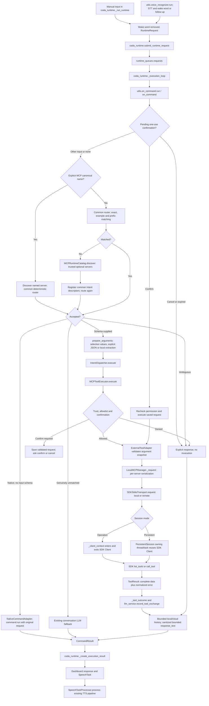

# Following a tool call through CODA

This is a technical reading guide for the implemented MCP framework. It describes
the code on `feature/mcp-and-tools`, rather than an ideal future architecture.
Read one stop at a time. The excerpts omit unrelated lines; explanatory comments
are annotations for this guide, not extra requirements on integration authors.

An **MCP server** exposes named tools with JSON input schemas. CODA is the
**client/host**: it connects, discovers those tools, decides which action the user
requested, checks permissions, and invokes the selected tool. A **transport**
carries protocol messages: local stdin/stdout (`stdio`) or remote Streamable HTTP.
A **session** is the connected client and its negotiated protocol state.

## The real execution chain



Configuration loading is a separate startup path:
`coda_runtime._run_runtime` → `configure_intent_router` → `MCPRuntimeCatalog` →
`LocalMCPManager.from_directory` → `discover_definitions`. This launches nothing.
After updater handoff acknowledgement, `start_tools` warms only explicitly eager
servers in a background thread. The main execution worker still handles one user
request at a time; independent MCP locks do not make the host a parallel action
planner. Voice capture remains on its own worker.

## Stop 1: define a connection and its authority

`ai/mcp/config.py: LocalServerDefinition` is a frozen dataclass. **Frozen** means
its fields cannot be reassigned. `ai/mcp/remote.py: RemoteServerDefinition` provides
the corresponding checked HTTP endpoint/header configuration.

```python
trusted: bool = False
allowed_tools: frozenset[str] = frozenset()
confirm_tools: frozenset[str] = frozenset()
session_mode: str = "operation"
startup_mode: str = "lazy"
idle_timeout_seconds: float | None = None
```

Trust authorizes starting a local executable or connecting to a remote endpoint.
The allowlist separately authorizes exact original tool names. A trusted server
with an empty allowlist may be discovered, but none of its tools may execute.
`confirm_tools` must be a subset of the allowlist; confirmation never grants
permission to a tool outside that list.

Defaults preserve operation-scoped behavior. Persistent mode retains a client;
`None` is indefinite retention and a positive idle duration closes an unused
client. Eager startup is valid only for persistent mode. Definitions reject
invalid types, non-finite/non-positive timeouts and invalid lifecycle choices.

Local `env` maps child variable names to parent environment variable names.
Remote `header_env` maps header names to environment variable names. Neither
stores literal secrets. Remote URLs require HTTPS except loopback HTTP, reject
userinfo/query/fragment credentials, and retain TLS certificate verification.
Environment references resolve at connection time; a retained session retains
the credentials with which it connected until retired/replaced.

Checkpoint: why should trusting a process not automatically authorize every tool
that process advertises?

## Stop 2: files become checked definitions

`discover_definitions` scans independent `*.json` files in `mcp_servers` or
`CODA_MCP_CONFIG_DIR`. `_read_definition` selects stdio or Streamable HTTP and
constructs the appropriate CODA dataclass. JSON duplicate keys are rejected,
not silently overwritten. Unknown settings, malformed files, invalid references,
duplicate IDs and per-file symlinks become safe per-file `configuration_error`
results. Valid neighboring files remain usable. A missing directory is empty.

```python
for path in sorted(directory.glob("*.json")):
    # Loading is validation only; it does not call the SDK.
    definition = _read_definition(path)
    if definition.name in servers:
        raise ValueError("MCP server id is duplicated.")
    servers[definition.name] = definition
```

The constructor of `LocalMCPManager` stores independently locked server runtimes.
Its name is retained for compatibility; it now accepts both local and remote
definitions. `ConfigurationDiscovery.errors` and `MCPRuntimeCatalog.errors`
are programmatically inspectable. There is no configuration-management UI yet.

## Stop 3: the tool catalog becomes common Intents

`MCPRuntimeCatalog.discover` connects trusted unattempted servers concurrently,
with up to eight discovery workers. Each server has its own timeout and result.
Exact, alias, example and prefix matches avoid lazy discovery. When those rules
miss, discovery precedes classification so the model sees both native and MCP
capabilities on its first call. A natural-language native request can therefore
incur initial discovery latency too. Initial failures are remembered rather than retried on every turn;
reconfigure/restart to retry. The catalog is a snapshot, not live subscriptions.

An explicit `mcp.<server>.<tool>` request discovers only that server before
routing. The common router uses exact/prefix matching for this lookup, so first
use does not wait for a classifier against an incomplete native-only catalog.
Unavailable or misspelled explicit tools also skip classification/fallback.
Natural-language requests use one classifier call after discovery, rather than
an earlier native-only classification followed by a second classification.

`LocalMCPManager.discover` calls `_request(server_id, "discover")`, then checks the
entire returned catalog using a temporary `IntentRegistry`. Invalid names,
duplicate normalized names or invalid schemas reject that catalog atomically.
No half-validated catalog is published. Pagination has a tool limit and rejects
repeated cursors. Retirement generations prevent stale discovery publication.

```python
intent = Intent(
    name=f"mcp.{server_id}.{name.lower()}",
    description=definition.get("description") or f"Run {name} on {server_id}.",
    parameters=parameters, source="mcp", input_schema=schema,
)
check_registry.register(intent)
pending[intent.name] = (server_id, name, intent)
```

The public name is namespaced, such as `mcp.example.echo`. The original server
name `echo` is retained privately for SDK calls and allowlist matching. Parameter
descriptions come from schema properties and required fields. Tool descriptions
cannot choose a command, endpoint, credentials or permissions.

## Stop 4: selection and argument values are separate

`ai/intents/router.py: IntentRouter.route` tries exact name/alias, declared example,
command prefix, then the optional `LocalClassifierStrategy` from
`ai/intents/factory.py: create_router`. Acceptance defaults to 0.75; candidates
from 0.40 request clarification. Matching never branches on `source`.

The classifier receives names, descriptions, parameters and `input_schema` in
`_build_intent_catalog`. It returns an `IntentResult` with canonical name,
confidence and optional `arguments`. A schema describes possible calls; the
arguments describe **one** call. Local classification still requires a configured
working local provider, normally Ollama or llama.cpp.

`ai/tools/arguments.py: prepare_arguments` uses this order:

1. Structured arguments returned with selection.
2. Explicit JSON after the canonical name, e.g. `mcp.example.echo {"message":"hi"}`.
3. An empty object for an exact name-only invocation.
4. A configured local provider to extract values for the selected schema.

Every path validates a snapshot against `compile_input_schema` and
`validate_arguments` in `ai/tools/validation.py`. No type coercion, invented
defaults or network retrieval of schema references occurs. Missing required
values produce an explicit invalid/incomplete-argument response, with no tool
invocation. The user sends a fresh clarified request; there is no multi-turn slot
filling. Native commands have no schema by default and parse their original
`IntentRequest.message` themselves.

Checkpoint: where does `"type": "string"` belong, and where does `"message": "hi"`
belong? The former is schema metadata; the latter is one invocation's value.

## Stop 5: permission, confirmation and execution

`utils/on_command.py: _dispatch_intent` registers the resolved MCP executor with
the same `IntentDispatcher` used for native commands. `MCPToolExecutor.execute`
rejects stale capabilities/configuration revisions, calls `_permission`, and
uses `ExternalToolAdapter` to revalidate arguments immediately before invoking.

```python
adapter = ExternalToolAdapter(
    self._intent,
    lambda arguments: self._manager._request(
        self._server_id, "invoke", tool_name=self._tool_name,
        arguments=arguments, cancel_event=cancel_event,
    ),
)
return adapter.execute(request)
```

`_permission` first checks trust and the allowlist. An optional host
`permission_decider(server_id, original_tool_name, request)` returns `allow`,
`deny` or `confirm`. Exceptions/unknown decisions deny. This is the extension
point for context-sensitive policy; JSON configuration does not execute policy
code and no automatic destructive-action scoring is implemented.

If confirmation is needed, the runtime stores a deep-copied validated request,
its executor and a monotonic expiry 60 seconds ahead. It asks the user to
confirm/cancel. Approval is consumed once, rechecks current permissions and
does not authorize a different request. Other input, expiry, cancellation,
reconfiguration and shutdown invalidate pending approval. Runtime stop phrases
clear approval even if no action is currently executing. Voice follow-up can
accept `confirm` without a wake word while its existing window remains open;
manual input still requires `coda confirm`. Use `coda no`/`coda cancel` to decline.

The SDK boundary also checks trust and the allowlist before connecting. Accepted
failures and ambiguous/denied/confirmation outcomes stop that path. Genuinely
unmatched input retains conversation fallback. No tool-action retry, alternative
tool fallback or accepted-action LLM reinterpretation is implemented.

## Stop 6: sessions, concurrency and cancellation

`LocalMCPManager._request` checks cancellation, acquires a per-server lock with
a bounded queue deadline, and checks the retirement generation again. Other
servers have independent locks. `retire` sets an event, invalidates queued work,
waits for active cleanup and closes a retained session. Later requests may
reconnect. `close` permanently rejects new work. `replace_definition` holds the
retirement barrier while replacing configuration and invalidating the catalog.
The executor's configuration revision is also checked inside the acquired server
lock, preventing a configuration change between permission and invocation from
submitting a stale call.

`ai/mcp/transport.py: SDKStdioTransport.request` retains its compatibility name
but supports both transports. `_client_context` owns all SDK-specific types:

```python
# Local: the SDK owns launching, closing stdin, termination and process reaping.
async with Client(stdio_client(parameters, errlog=errlog),
                  read_timeout_seconds=definition.timeout_seconds,
                  input_required_max_rounds=0) as client:
    yield client
```

```python
# Remote: CODA owns the HTTP client, never the remote server process.
async with httpx2.AsyncClient(
    headers=definition.headers(), timeout=httpx2.Timeout(definition.timeout_seconds),
    event_hooks={"response": [inspect_response]}, trust_env=False,
) as http:
    async with Client(
        streamable_http_client(definition.url, http_client=http,
                               max_sse_event_size=definition.max_sse_event_bytes),
        read_timeout_seconds=definition.timeout_seconds, input_required_max_rounds=0,
    ) as client:
        yield client
```

Operation mode enters/exits for every request. Persistent mode delegates to
`ai/mcp/session.py: PersistentSession`. Its one thread runs `anyio.run(perform)`;
the same async task enters and exits the SDK context and consumes queued
`_Operation` jobs. This avoids moving an async context's cleanup onto another
task/event loop. Concurrent first use through the manager creates one retained
client. Idle deadlines begin only after completed operations.
An idle session that starts closing rejects new jobs before enqueueing them.
The transport waits for cleanup and creates a fresh client for such an unsubmitted
request. This is connection recovery; a queued/submitted action is never replayed.

A watcher checks cancellation/retirement and a monotonic deadline every 10 ms.
Startup covers launch/negotiation; action timeout starts once connected. Active
timeout/cancellation conservatively tears down the client; a healthy completed
domain-error or output-limit result may retain it. Cleanup has SDK bounded waits
and may add time beyond the action deadline. Synchronous APIs belong on worker
threads, not inside an already running async loop.

States are `configured`, `starting`, `connected`, `available`, `retired`, `failed`.
`available` means the catalog validated; it is not a liveness guarantee. Idle
retirement does not synchronously update the manager's catalog state. A later
request reconnects when the underlying session is closed. Server memory can be
lost on retirement/failure; remote persistence additionally depends on the server.

Remote `reconnect_backoff_seconds` rejects premature later calls; it never queues
an automatic retry. The SDK may resume an existing SSE response with GET, without
CODA resending an accepted `tools/call`. Modern protocol negotiation can use
`server/discover` without the older HTTP session-ID header. There is no assumption
that all supported servers negotiate identically.

## Stop 7: errors and the full-result boundary

The SDK uses `list_tools` or `call_tool`; the transport converts its result to JSON
and wraps `ToolResult(success, data, error)`. SDK types stay behind this boundary.
`isError` becomes `mcp_tool_error` with a safe message and the separate full data.

| Outcome | What the caller receives |
| --- | --- |
| Invalid configuration/credential reference | `configuration_error` |
| Unknown server / stale tool | `server_not_found` / `tool_not_found` |
| Trust/allowlist denial | `permission_denied` |
| Host approval needed | `confirmation_required` before action invocation |
| Schema mismatch | `invalid_arguments` before action invocation |
| Startup/reachability failure | `connection_error` |
| Bad protocol/disconnect after connection | `mcp_protocol_error` |
| HTTP 401/403 | `authentication_error` |
| Deadline / cancellation | `timeout` / `cancelled` |
| Decoded response cap / HTTP 413 | `output_limit` |
| Remote reconnect delay | `connection_backoff` |
| Cleanup exceeded caller wait | `cleanup_timeout` |

`max_output_bytes` checks decoded serialized output after SDK parsing. It is not
a transport-frame or peak-memory ceiling. Remote `max_sse_event_bytes` caps an
SSE event before parsing, can be increased/disabled, and does not cap JSON bodies.
The remote server separately controls HTTP request/body limits. Large accepted
results still do not become large conversation entries.

Stderr is discarded; SDK/HTTP raw diagnostics on the operation/session thread
are suppressed. Runtime debug input and display results use existing detection
and sanitization. Detection is imperfect: do not treat it as a universal secret
scanner. Full tool payloads are never printed wholesale or added to telemetry.

## Stop 8: result text reaches history, the dashboard and speech

`_tool_outcome` retains full data in `CommandResult.tool_result` and calls
`ai/tools/presentation.py: prepare_tool_response` for display and speech. Server
text blocks are preferred; JSON text is rendered as readable values, with a
structured-content fallback when no text is available. A single-field echo
result `{"message":"Hello from CODA"}` becomes just `Hello from CODA`.
Multi-field objects become labeled text. Protocol metadata and binary content
are excluded; no readable content gets `Tool completed.`. Detected secrets are
sanitized before the response is bounded to 1200 characters. This deterministic
presentation uses no extra LLM call. Failure uses a safe normalized error message.

`utils/llm_service.py: record_tool_exchange` adds one user/assistant exchange:

```python
local = prepare_tool_context(result, for_cloud=False)
cloud = prepare_tool_context(result, for_cloud=True)
# Each defaults to 2000 chars. Cloud privacy inspects the full envelope first.
conversation_log.append(_new_message("assistant", local, cloud_content=cloud))
```

The actual method also handles unavailable representations, analyzes the user
request, and trims history. `ai/tools/context.py: prepare_tool_context` applies
existing cloud raw/sanitize/summarize/block policy to the complete structured
envelope before bounding. `sanitize_structure` handles nested strings and keys.
Local history retains its existing local policy; provider-specific rendering in
`_build_messages_for_provider` selects `content` or `cloud_content`. Full results
are unchanged. Follow-up conversation sees bounded history, not a new tool plan.

`coda_runtime._create_execution_result` carries `response_text` and cancellation
status. `_execution_loop` checks cancellation, records the response on the
dashboard, and queues a `SpeechTask`. `runtime/speech_worker.py:
SpeechTaskProcessor.process` uses the existing TTS providers. The full tool result
does not travel in the speech task and there is no persistent full-result store.

## Build your first integration yourself

A standalone MCP server is sufficient. You do **not** need a matching CODA
command module. Native modules are appropriate for native commands; the generic
MCP adapter supplies connection, discovery, argument handling and execution for
every configured MCP tool. Do not add per-integration routing branches.

1. Choose one read-only capability and define its input/output contract first.
   Create your server in your own integration folder and a separate virtual
   environment. Install the pinned SDK: `python -m pip install mcp==2.3.0`.
2. Start with this learning-only echo skeleton; replace it with your own logic:

   ```python
   from mcp.server import MCPServer

   server = MCPServer("my-first-server")

   @server.tool(structured_output=True)
   def echo(message: str) -> dict[str, str]:
       """Return the supplied message so we can trace a complete call."""
       return {"message": message}

   if __name__ == "__main__":
       server.run(transport="stdio")
   ```

   The decorator exposes the function as a tool; parameter annotations generate
   its input schema. A docstring helps local selection. stdout belongs to MCP
   protocol messages: use stderr for development diagnostics, never `print` to
   stdout. CODA deliberately discards server stderr.
3. Create an ignored `mcp_servers/my_first.json`, using absolute interpreter and
   script paths for your machine:

   ```json
   {
     "id": "my_first",
     "transport": "stdio",
     "command": "/absolute/path/to/integration-venv/python",
     "args": ["/absolute/path/to/your/server.py"],
     "trusted": true,
     "allowed_tools": ["echo"],
     "confirm_tools": [],
     "session_mode": "persistent",
     "startup_mode": "lazy",
     "idle_timeout_seconds": 300,
     "env": {}
   }
   ```

   Windows uses the venv's `Scripts/python.exe`; Linux uses `bin/python`. JSON
   Windows paths require escaped backslashes or forward slashes. Only set trust
   after reviewing the executable/server. Use explicit environment references
   for credentials, and keep real destructive tools denied until policy is ready.
4. Restart/reconfigure CODA and first use an exact manual request, including the
   wake word: `coda mcp.my_first.echo {"message":"hello"}`. This isolates transport
   and schema behavior from model interpretation. No local classifier is needed
   for this exact JSON form.
5. Configure `CODA_LOCAL_PROVIDERS` and enable `CODA_INTENT_LOCAL_CLASSIFIER` for
   natural-language selection. Try a clear request matching your tool's
   description. Voice uses the same path after transcription. If ambiguous,
   provide a fresh more explicit request; if required values are absent, supply
   them rather than weakening the schema.
6. Add `echo` to `confirm_tools` temporarily to practise approval. In manual
   mode respond with `coda confirm`; in voice use a wake word or the follow-up
   window. Review permissions before adding any real effect.
7. Add meaningful server tests for your service behavior, then host tests for
   schema failures, denial, cancellation and failure without replay. Use
   `tests/test_mcp_runtime.py`, `test_mcp_sessions.py`, `test_mcp_intent_runtime.py`
   and `test_mcp_remote.py` as framework examples, not real integrations.

For remote deployment, use `server.run(transport="streamable-http", host=...,
port=...)` and configure [a remote endpoint](mcp-remote.md). You are responsible
for deployment, endpoint authentication, TLS and service credentials. CODA's
headers authenticate its MCP connection; downstream service authentication inside
your server is a separate responsibility.

## Supported, planned and unsupported

Implemented: stdio and Streamable HTTP, independent file definitions, lazy/eager
persistent clients, idle/explicit retirement, common routing, schema validation,
allowlists, explicit confirmation, bounded privacy-aware result context, safe
timeouts/cancellation/recovery and host cleanup.

Future possibilities, not shipped: permission profiles/UI and richer contextual
scoring; embedding-based intent matching (v1.6); dynamic result summaries; live
catalog subscriptions/configuration watching; configurable equivalent-action
fallback. Initial discovery retry requires reconfiguration/restart.

Unsupported here: legacy HTTP+SSE configuration, interactive OAuth/token refresh,
MCP sampling/elicitation/input-required continuations, remote process management,
automatic action retries, autonomous multi-tool planning and integration-specific
commands. Natural-language reliability depends on the configured local model;
exact JSON requests provide a deterministic baseline.

Real integrations remain the integration author's responsibility. This document
and the disposable fixtures supply a tested framework and a reading route.
# Bundled server follow-up

See [the bundled lifecycle](mcp-bundled.md) for the data-only catalog, settings
validation, independent enablement and archive update preservation. These extend
the existing transport and permission flow without granting trust from metadata.
